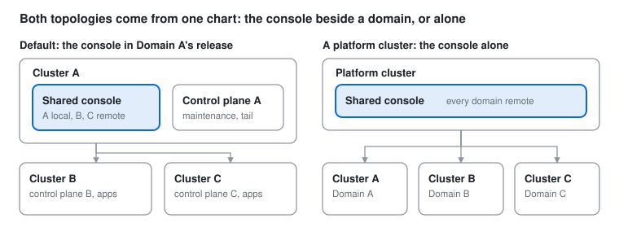
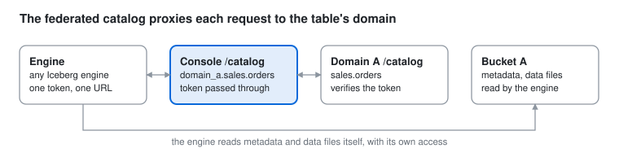

# Midstream multi-domain specification

**Status:** design specification, agreed in review on 2026-10-26; not yet built. §1 records the
decisions it follows and §15 those taken in review; §14 is the delivery plan. Once built, the
handbook (20 — Domains and the shared console) supersedes this document where they differ.

Written 2026-10-26 against `main` at bc557cb (1.0.0-rc.2), as the specification of option C of the
proposal *Unifying Midstream across clusters*: any number of Midstream domains under one shared
console, one sign-in through Microsoft Entra ID, GitHub or Google, and search, SQL and one catalog
across domains. Every claim about current behaviour was checked against the code and the handbook
sections named beside it.

**Audience:** the implementer and the reviewers. The owner's decisions are recorded here in full, so
that the build can proceed without coming back to them.

---

## 1. Purpose and the decisions this specification follows

This specification turns option C of the proposal into a buildable design: any number of Midstream domains under one shared console at one URL, one sign-in through Microsoft Entra ID, GitHub or Google, and search, SQL and one catalog across domains. It is the review contract: every section below follows the decisions in this table, and §15 records the decisions taken in review.

| Decision | Choice |
| --- | --- |
| Option | C: one console over many control planes (B), with single sign-on; the end state includes search, SQL and a federated catalog across domains (the proposal's phase 3) |
| Domains | Any number, each configured under its own entry in Helm; this document calls them Domain A, Domain B and Domain C (`domain_a`, `domain_b`, `domain_c`) |
| Compatibility | None. A clean slate: a fresh install, new directories, no migration of sessions, tokens or settings |
| Sign-in | Entra ID, GitHub and Google through the console, and any other OpenID Connect provider through a generic `oidc` provider (decided 2026-10-26: Dex for testing, Okta, Keycloak or Auth0 elsewhere); password sign-in stays, one sign-in per domain. Provider identity is Helm configuration, shown in the console; the switches that are safe to change at run time are adjustable there |
| First-sign-in policy | `open` by default, configurable per domain in Helm and on the Settings page; `invited` available; `request` later (§5) |
| Password sign-in off | A domain may turn it off; accounts holding Administrator always keep it |
| Group claims | Not used: a provider says who a person is, never which Midstream groups they are in |
| Entra ID | One tenant per deployment |
| Google | Production restricted to the company's hosted domains |
| Guests | The Guest group's view, per domain, as today |
| Federated tokens | Minted in any domain the person is signed in to |
| Table names | Explicit wherever more than one domain can appear — in SQL always, on the all-domains pages, in search, in the federated catalog's snippets, in a token's dataset limits and in errors; the short `<dataset>.<table>` inside a domain's own pages (§8) |
| DuckDB | No flattened names in the federated catalog; its nested-namespace support is verified in the build, and a domain's own catalog is DuckDB's path if it lacks it (§9) |
| Repository and chart | One repository, one chart. A release deploys the shared console alone, a domain's control plane and apps alone, or both |
| Where the console runs | In a platform cluster or beside one domain's control plane; both supported, the latter the default. Every domain's control plane and tail URLs are set in the console's configuration |
| Lake access | One read-only identity with access to every domain's bucket |
| URLs | `/d/<domain>/…` under the console's hostname; each domain's old hostname redirects there |
| Redirects | Rendered by the chart for Gateway API and nginx; the rule documented in the handbook with examples for Gateway API, nginx, Istio, Traefik and HAProxy, and a placeholder for any other controller (§4) |
| Per-domain consoles | None |
| Settings home | One domain, chosen in Helm; the chart refuses zero or two |
| Test builds | Test builds reach the test cluster through a temporary container registry and Python package index on it, removed at the end; nothing is pushed to GitHub, GHCR or PyPI without the owner's approval (decided 2026-10-26) |
| Test providers | Dex (through `oidc`) for automated checks; GitHub: an OAuth App on the owner's account; Google: an OAuth client in the owner's GCP account; Entra ID: last, set up with the owner, step by step, when the build reaches it |
| Documentation | The handbook and the console handbook updated with the build; an architecture graphic of the multi-domain system once everything is tested |

## 2. Terms

| Term | Meaning |
| --- | --- |
| Domain | One Midstream deployment: a control plane with its maintenance and tail apps, runtimes, lake prefix and directory, on one Kafka cluster in one Kubernetes namespace, installed by one Helm release. It has an id (`domain_a`: a URL segment, a SQL catalog name and a namespace level) and a display name (Domain A) |
| Shared console | The one console deployment serving every domain: a Node backend and a React client in one process, as today, reached at one URL |
| Registry | The console's list of domains and how to reach each: `console.domains` in Helm, rendered into the console's configuration |
| Local domain | The registry entry for the control plane in the console's own release, reached through its Services |
| Settings home | The one domain whose `console` settings scope stores the console's own overrides |
| Session per domain | A control-plane session token for one domain, kept by the browser in a cookie of its own |
| Provider | A way of signing in: `password`, `entra`, `github`, `google` or `oidc` |
| First-sign-in policy | What a domain does when someone signs in through a provider and has no account there |
| Federated access token | A signed token for engines that every domain accepts where its owner has an account |
| Federated catalog | The console's Iceberg REST catalog over every domain, with namespaces `<domain>.<dataset>` |
| Canonical table name | `<domain>.<dataset>.<table>`, the same in the console's SQL and in the federated catalog |

## 3. Topologies and the Helm chart

One chart deploys both kinds of release — a domain (the control plane and its apps) and the shared console — and a release may hold both, which is the default. Every release names the domain it belongs to; the console release holds the registry.



Left, the default: one release holds Domain A's control plane and the console, which reaches Domains B and C through their API hostnames. Right: a console-only release in a platform cluster, every domain remote.

**Values.** The additions; today's values stay beneath them.

```yaml
domain:                        # every domain release: which domain this is
  id: domain_a                 # [a-z][a-z0-9_]{0,31}: a URL segment, a SQL catalog name, a namespace level
  name: Domain A

controlPlane: { enabled: true }   # the control plane, its agents, tasks, tables, views and RBAC
maintenance:  { enabled: true }
tail:         { enabled: true }

console:
  enabled: true                # the shared console; false in a domain-only release
  url: https://midstream.mycompany.com   # the one URL; every release needs it for its redirects
  domains:
    - id: domain_a
      name: Domain A
      local: true              # this release's control plane and tail app, reached by their Services
      settingsHome: true       # exactly one entry
    - id: domain_b
      name: Domain B
      controlPlaneUrl: https://domain-b-api.mycompany.com
      tailUrl: https://domain-b-api.mycompany.com
      serviceTokenSecret: { name: domain-b-auth, key: service-token }
  sso:                         # the console's OAuth clients; redirect URI <console.url>/api/auth/sso/<provider>/callback
    entra:  { enabled: true, tenantId: <tenant>, clientId: <id>, clientSecretSecret: { name: console-sso, key: entra } }
    github: { enabled: true, clientId: <id>, clientSecretSecret: { name: console-sso, key: github } }
    google: { enabled: true, clientId: <id>, clientSecretSecret: { name: console-sso, key: google } }

auth:
  existingSecret: ""           # signing-key, previous-signing-key, service-token, federation-key, previous-federation-key, bootstrap-admin-*
  sso:                         # what this domain's control plane accepts
    entra:  { enabled: true, tenantId: <tenant>, clientId: <id> }
    github: { enabled: true, clientId: <id> }
    google: { enabled: true, clientId: <id>, hostedDomains: [] }
    firstSignIn: open          # or invited (§5); adjustable later on the Settings page
    allowedEmailDomains: []    # empty: any; adjustable later
  passwordSignIn: true         # adjustable later; administrators always may

route:
  enabled: true
  hostnames: [domain-a-api.mycompany.com]            # this domain's API: the control plane, /catalog and /tail
  consoleHostnames: [midstream.mycompany.com]         # where console.enabled
  redirectFrom: [domain-a-midstream.mycompany.com]    # old person-facing hostnames, to <console.url>/d/domain_a/<path>
```

**Rules the chart enforces**, failing the render otherwise: a console release has exactly one `settingsHome`; domain ids are unique and well formed; `local: true` needs `controlPlane.enabled`; a remote entry needs `controlPlaneUrl`, `tailUrl` and `serviceTokenSecret`; `console.url` is set whenever `console.enabled` or `redirectFrom` is; a console-only release renders no Kaspr resource, Role or auth Secret reference. Three CI values files cover the topologies — `default` (the console beside Domain A), `console-only`, `domain-only` — and `test_agent_manifests.py` renders and checks all three.

**What each component receives.** The chart renders the registry into a ConfigMap, `domains.json` — ids, names, URLs, `local`, `settingsHome` — mounted at `/etc/midstream/domains.json` (`CONSOLE_DOMAINS_FILE`), and one environment variable per domain, `CONSOLE_DOMAIN_<ID>_SERVICE_TOKEN`, from the named Secret (the local domain's from the release's auth Secret). The SSO client secrets arrive as `CONSOLE_SSO_<PROVIDER>_CLIENT_SECRET`. The control plane receives `DOMAIN_ID`, `DOMAIN_NAME`, `AUTH_SSO_*` and the federation key from its auth Secret.

## 4. Hostnames, routes and redirects

People use one hostname; each domain has one API hostname; each domain's old hostname redirects into the console.

| Hostname | Serves | Rendered by |
| --- | --- | --- |
| `midstream.mycompany.com` | The console: its pages, `/api`, the federated catalog at `/catalog`, each domain's own catalog at `/d/<domain>/catalog` | The console release (`route.consoleHostnames`) |
| `domain-a-api.mycompany.com` | `/tail/*` to the tail app's Service; everything else to the control plane's Service: its API and its `/catalog` | Each domain release (`route.hostnames`) |
| `domain-a-midstream.mycompany.com` | A `301` to `https://midstream.mycompany.com/d/domain_a/<path>`, the path kept | Each domain release (`route.redirectFrom`): an HTTPRoute `RequestRedirect` filter with `ReplacePrefixMatch` (`/` to `/d/domain_a/`), or the nginx annotation on an Ingress; for any other controller the chart renders nothing, and the rule below is applied by hand |

The local domain is reached through its Services, `http://<release>-control-plane-app-api:6065` and `http://<release>-tail-app-api:6065`, as today; a remote domain through its API hostname over TLS. An API hostname exposes every control-plane view: each view authorizes its caller, and only `GET /system/version` is public (handbook 18 §18.7). §12 says what to put in front of it.

**The redirect rule**, where the chart does not render it: every request to an old hostname answers `301` with `Location: <console.url>/d/<domain id><the original path and query>`. Handbook 20 carries ready-to-paste examples — Gateway API (an HTTPRoute with `RequestRedirect`), nginx Ingress (the `permanent-redirect` annotation), Istio (a `VirtualService` redirect), Traefik (a `RedirectRegex` middleware), HAProxy Ingress (a redirect annotation) — and a placeholder that shows where the three values go for any other controller: the old hostname, the console's URL and the domain id.

**The console's URLs.** Console-level pages have no domain; everything about one domain lives under `/d/<domain>/`.

| Path | Page |
| --- | --- |
| `/`, `/materializations`, `/datasets`, `/search` | All domains: the overview, the lists and search, each row linking into its domain |
| `/sign-in`, `/sign-in/<domain>` | The providers; a password sign-in for one domain |
| `/settings/console`, `/settings/domains`, `/settings/account`, `/settings/history` | The console's own settings (stored in the settings home), the registry with each domain's health and version, your sessions and tokens, every domain's change history merged |
| `/d/<domain>/materializations[/:id[/:tab]]`, `/d/<domain>/datasets[/:name[/:tab]]` | As today, inside the domain |
| `/d/<domain>/settings/{control-plane,runtimes,sign-in,users,groups,roles,audit,deployment}` | The domain's settings and directory |

The API mirrors it: `/api/…` for console-level routes, `/api/d/:domain/…` for today's routes inside a domain, `/api/stream/fleet` for the merged fleet and `/api/d/:domain/stream/…` for a domain's streams. A domain id is checked like a materialization id — `^[a-z][a-z0-9_]{0,31}$`, none of DuckDB's reserved words (`shared/tableNames.ts`), none of `api`, `d`, `catalog`, `iceberg`, `temp`, `system` — by the chart and by the console at start; an unknown domain in a path is `404 unknown_domain`.

## 5. Identity: providers, sign-in, sessions

Three providers at the console, one sign-in, one session per domain; password sign-in stays, one domain at a time. The console runs the provider's flow; every control plane verifies the result itself, so the console never asserts who someone is.

| Provider | Protocol | The console | Each control plane verifies | The identity it records |
| --- | --- | --- | --- | --- |
| Microsoft Entra ID | OpenID Connect: authorization code with PKCE, a confidential client | Sends the browser to `login.microsoftonline.com/<tenant>/oauth2/v2.0/authorize`, exchanges the code for an ID token | The ID token's signature against the tenant's keys (`jwks_uri` from discovery), `iss` = `https://login.microsoftonline.com/<tenant>/v2.0`, `aud` = the client id, `exp`, `nonce`, `tid` = the configured tenant | `provider: entra`, `subject: <oid>`; the email from `email` or `preferred_username`; the name |
| Google | OpenID Connect, the same flow at `accounts.google.com` | The same | The signature against Google's keys, `iss` = `https://accounts.google.com`, `aud`, `exp`, `nonce`, `email_verified` true, `hd` among `hostedDomains` when any are set | `provider: google`, `subject: <sub>`; `email`; the name |
| GitHub | OAuth 2.0 only: no ID token | The code flow at `github.com/login/oauth` with scopes `read:user user:email`; receives an access token | `GET https://api.github.com/user` and `/user/emails` with that token, used once and never stored: the account's id and its primary, verified email | `provider: github`, `subject: <id>`; that email; the name |
| Any OpenID Connect provider (`oidc`) | OpenID Connect, the same flow against a configured issuer: Dex, Okta, Keycloak, Auth0 | The same, with the endpoints from the issuer's discovery document | The signature against the issuer's keys, `iss` = the configured issuer, `aud`, `exp`, `nonce`, and `email_verified` unless the provider is configured to vouch for emails without it | `provider: oidc`, `subject: <sub>`; `email`; the name |
| Password | — | Forwards email and password to the chosen domain | As today (handbook 18 §18.6) | The account's own |


Steps 5 to 10 run in parallel for every domain in the registry. For GitHub, step 4 yields an access token and step 7 asks GitHub's API instead of checking keys. The console ends up holding only the sessions.

**The exchange.** `POST /auth/login` takes `{"provider": "entra" | "github" | "google", "credential": {"id_token": "…"} | {"access_token": "…"}, "nonce": "…"}` beside today's `{email, password}`, and answers as today: `200` with a session whose `method` is `sso:<provider>`. Refusals name their reason: `403 provider_disabled`, `403 no_account` (the policy below), `403 email_not_allowed`, `403 email_unverified`, `403 account_deactivated`, `401 invalid_credential`, `503 provider_unreachable`. The view is `async`, waiting on the provider's keys or API off the event loop (handbook 02 §2.8), with a keys cache per provider refreshed when a token names an unknown `kid`, at most once a minute. The console calls every domain in the registry in parallel and sets one cookie per domain that answered `200`; the Domains panel shows each outcome — *Signed in*, *No access* with the reason, *Unreachable* — and lets a person try a domain again.

**Finding the account in a domain**, in order: (1) the user holding the external identity (provider, subject); (2) else, when the provider vouches for the email — Google with `email_verified`, GitHub's primary verified email, Entra ID within the configured tenant — the user with that email, linked to the identity from then on (audit `user.identity_linked`); (3) else the first-sign-in policy. Allowed email domains, when set, are checked before any of it.

**First-sign-in policy**, a choice per domain. It decides one thing only: what a domain does the first time someone it has never seen signs in through a provider — whether an account is made for them, and with what. Someone the domain already knows is linked to their account under every policy.

| Policy | Someone unknown to the domain | Who has access by default | Good for | Risk |
| --- | --- | --- | --- | --- |
| `open` (the default) | An account is created in All Users (audit `user.provisioned`) | Everyone the provider and the allowed email domains admit. All Users holds Viewer, and Dataset Reader on every dataset made with the default grant, so they read every such dataset until its owner narrows it | A domain meant for company-wide reading; onboarding without administrators | Data visible to anyone with a company login unless owners narrow All Users |
| `invited` | Refused: *No access in Domain B — ask its administrator*. An administrator adds the account (email, groups); the next sign-in links to it | Nobody until invited | A domain whose data needs deliberate access | Onboarding goes through each domain's administrators |
| `request` (not in this build) | An account is created deactivated, as *pending*, for an administrator to activate | Nobody until approved | Self-service onboarding with approval | A pending state on the users list and the sign-in page; can follow later |

**Password sign-in** is per domain, as today, at `/sign-in/<domain>`. `password_sign_in_enabled` turns it off for a domain except for accounts holding Administrator, so the bootstrap administrator can always get in (handbook 18 §18.8). Someone created through a provider has no password until an administrator sets one.

**Sessions.** One cookie per domain, `midstream_session_<domain>` — HttpOnly, `SameSite=Lax`, `Secure` behind TLS — holding that control plane's token, renewed on its own `refresh_after` and cleared when its control plane refuses it. A request under `/api/d/:domain/` carries that cookie's token; an all-domains request carries each. `GET /api/auth/session` answers `{domains: {<id>: {authenticated, principal, session, error}}, providers}`, and the client keeps a principal per domain. Signing out is per domain or everywhere. A domain without a cookie is visited as its guest. Browsers allow dozens of cookies per site, so the cookie does not bound the number of domains.

**Where each setting lives.**

| Setting | Helm | In the console | Why |
| --- | --- | --- | --- |
| The console's OAuth clients: tenant, client ids, secrets, redirect URI | `console.sso.*` | Read-only, Settings › Console › Deployment: each provider *configured* or not | A secret never travels the settings topic; a client registration changes with a deploy |
| What a domain accepts: tenant, client ids, hosted domains | `auth.sso.*` | Read-only, the domain's Settings › Deployment | Must match the console's registration |
| `sso_entra_enabled`, `sso_github_enabled`, `sso_google_enabled`, `sso_oidc_enabled` | Defaults from `auth.sso.<provider>.enabled` | Adjustable, the domain's Settings › Sign-in | Turning a provider off for one domain is safe at run time; the others keep working |
| `sso_first_sign_in` (`invited` or `open`), `sso_allowed_email_domains` | `auth.sso.firstSignIn`, `auth.sso.allowedEmailDomains` | Adjustable, the domain's Settings › Sign-in | Policy, not identity |
| `password_sign_in_enabled` | `auth.passwordSignIn` | Adjustable, the domain's Settings › Sign-in; administrators exempt | Never locks everyone out |
| Session lifetimes, lockouts, password rules | As today | As today | — |

## 6. Federated access tokens

One token lets an engine attach the federated catalog once and read in every domain where its owner has an account; each domain verifies it on its own, so no domain depends on another at request time. It replaces today's per-domain access token: there is one kind of token.

**Format.** `tok_<base64url claims>.<base64url HMAC-SHA256>`, signed with the **federation key**: `federation-key` in every domain's auth Secret, the same value everywhere, at least 32 characters, with `previous-federation-key` for rotation, as the session signing key has (handbook 18 §18.12). The claims are signed, not encrypted, and hold nothing secret.

| Claim | Holds |
| --- | --- |
| `jti` | The token id, 12 hex characters |
| `iss` | The domain that minted it |
| `own` | The owner: `{provider, subject}` for someone who signed in through a provider, else `{email}` |
| `perm` | `catalog.read`, optionally `catalog.write` |
| `ds` | Optional: the datasets it is limited to, as `<domain>.<dataset>` |
| `iat`, `exp` | Issued at; expiry, at most 365 days |

**Minting.** `POST /auth/tokens` on a domain the person is signed in to — the Account page lets them choose which — with `{name, permissions, expires_in_days, datasets?}`. That domain checks `catalog.read` on some dataset as today, records `token:<jti>` (owner, name, permissions, datasets, expiry) for its listing, writes `token.created` to its audit log, and answers the text once.

**Verifying**, in every domain (`identity/authorization.py::_token_principal`): the signature with the current or the previous federation key; `exp`; no `revoked:<jti>` record; the owner resolved to a local user by external identity, else by email, who must be active — `401 token_unknown_owner` otherwise; then, as today, the carried permissions intersected with what the owner holds on each dataset, and `ds` applied to this domain's datasets. A token never grants more than its owner holds in the domain that answers.

**Listing and revoking.** `GET /auth/tokens` lists the tokens a domain minted; the Account page shows every domain's. `DELETE /auth/tokens/{jti}` on the minting domain (the owner, or `users.manage`) records `revoked:<jti>` there and answers a **signed revocation** `{jti, exp, signature}`; the console forwards it to every other domain's `POST /auth/tokens/revocations`, which needs no session — the signature is the proof — and records the same. A domain unreachable at that moment is told again: each domain lists its revocations (`GET /auth/tokens/revocations?since=`, read with the service credential), and the console syncs them every five minutes. Revocation records expire with their tokens. Audit: `token.revoked` in the minting domain, `token.revocation_applied` elsewhere.

**Rotation and agreement.** Put the current key in `previous-federation-key` and a new one in `federation-key` in every domain's Secret within one change window, restart the control planes, and remove the previous key after the longest token lifetime. `GET /system/version` reports `federation_key_id`, the first 8 hex characters of the key's SHA-256, and the console's Domains page shows a domain whose key differs from the others'.

## 7. The shared console

The console keeps its shape — one Node process, one React client, no durable state of its own — with every singleton made one per domain and the domain in every path.

**Registry.** `domains.json` from the chart, read at start: `[{id, name, controlPlaneUrl, tailUrl, local, settingsHome}]`, plus `CONSOLE_DOMAIN_<ID>_SERVICE_TOKEN`. The console validates ids, URLs and the single settings home and refuses to start otherwise, then asks each control plane `GET /system/version`, which now reports its `domain` and `federation_key_id`: a control plane naming another id is marked *misconfigured* and served nothing, and a federation key that differs between domains is shown on the Domains page.

**Server.** A `Domain` holds a domain's `ControlPlaneClient`, `LiveStore`, `TopicCatalog` and tail client; a `Domains` map holds them all; the `ConsoleSettingsStore` is bound to the settings home. Today's route modules register once under `/api/d/:domain/`, behind a pre-handler that resolves `request.domain` or answers `404 unknown_domain`. Console-level routes: `/api/config` (the registry's public part — ids, names, the settings home, each domain's catalog URL — and the providers), `/api/health` (each domain's connectivity), `/api/auth/*` (the provider flows, the session map, sign-out), `/api/stream/fleet` (the domains' fleet snapshots merged, each item carrying `domain`, one connection for the overview), `/api/search`, `/api/runs/*` (a run is addressed by its id, as today, since a statement may span domains, §8) and `/catalog/*` (§9). The table reader, the run engine and the live tail are unchanged: a run reads a table at the location its domain recorded and asks that domain's tail app with that domain's session.

**Authorization.** `request.auth` becomes a map, domain id to the caller in that domain, resolved from the cookies and cached per token as today. `permit(permission)` on a domain route checks that domain; an all-domains route filters per item — a materialization shows if the caller may `materializations.view` in its domain, which a guest may by default; `requireOnDatasets` takes (domain, dataset) pairs and names the domain in a refusal.

**Client.** `DomainProvider` holds the registry from `/api/config` and the scope from the URL; `AuthProvider` holds a principal per domain; `useDomain()` and `useCan(permission, datasetId?, domainId?)`; the live hooks open one stream per domain in view. The switcher at the top of the sidebar — *All domains*, then each domain with its live dot — scopes the navigation, and `localStorage` remembers the last choice.

| Page | Across domains |
| --- | --- |
| Overview | A stat row per domain and the fleet's totals; *Needs attention* across domains, each row with its domain chip |
| Materializations | One list with a Domain column, domain filter chips and search over name, id and topics; **Create** asks which domain first, then today's dialog in that domain |
| Datasets | One list grouped by domain, each shown as *Domain A › sales*; a dataset's page is its domain's |
| Search (`⌘K`) | `/api/search?q=` over the materializations (name, id, topics, tables), datasets and tables of every domain the caller may see, from the live snapshots in memory; results link into their domain |
| Settings | Console-level: Console (stored in the settings home), Domains (the registry, health, versions, key agreement), Account, History (every scope of every domain, merged). Per domain, under `/d/<domain>/settings`: control plane, runtimes, sign-in, users, groups, roles, audit, deployment |
| Account | Sessions per domain, signed out one at a time or all at once; tokens per domain, with **New token** choosing the minting domain, permissions, datasets across domains and expiry; Connect snippets for the federated catalog and for each domain's own |

**Capacity.** One process polls N control planes at today's cadence each; each control plane sees the load of one console. Memory grows with the materializations of all domains (console 03 §3.4); DuckDB stays one instance. Two replicas with sticky sessions remain the way to run more than one (console 13 §13.4).

## 8. SQL across domains

A statement names any table its author may query, in any domain, as `<domain>.<dataset>.<table>`, and its sandbox holds exactly those tables' files.

**Names.** The domain is part of a table's name wherever more than one domain can appear, and left out where the page is already inside one. In SQL it is always there: a statement names a table `domain_a.sales.orders` — in DuckDB a catalog, a schema and a table — with logical columns as today, and its native Iceberg table `domain_a_iceberg.sales.orders`; a name without its domain is a `400` naming the full form, so a statement reads the same wherever it is pasted. The Data tab's completions insert full names, and so do the Connect panel's federated snippets and every error message. Inside `/d/<domain>/…` — the Tables panel, a dataset's page, the labels of the Schema, Data and Table tabs — a table is `sales.orders`, as today, with the domain in the page's header; the all-domains pages, search and a token's dataset limits always say `domain_a.sales`.

**Resolution.** `referencedTables` parses three-part names, and two-part names against the run's domain; each name is resolved through its domain's live snapshot — the dataset's name to the dataset, its table claim to the materialization, the table record to its location, as the REST catalog resolves a name (handbook 11 §11.8). An unknown name is `400` listing the canonical names the author may use. Authorization is per table, in its domain: `data.query` on the table's dataset with the caller's principal in that domain; no session there is `401` naming the domain; an export needs `data.export` the same way. A table in a domain the registry does not hold does not exist.

**The sandbox.** One DuckDB instance per statement, as today (console 12 §12.4): `ATTACH ':memory:'` as `<domain>` and as `<domain>_iceberg` for each domain named, a schema per dataset, views over the run's files; `allowed_paths` is the union of those files across buckets, which the one read-only identity reads through a single GCS secret (§10). Browse runs, profiles and exports keep their shape, and a statement's result is stored per run as today.

**The Data tab.** The editor's completions list the run's own tables first and, under *Other domains*, the tables the person may query elsewhere; the status line names the domains a statement read. Live follows the own domain's selected table as today; a statement that spans domains has *Auto re-run* only.

## 9. The federated REST catalog

The console serves one Iceberg REST catalog at `https://midstream.mycompany.com/catalog`, whose namespaces are `<domain>.<dataset>`; it proxies each request to the domain's control plane with the caller's own token and holds no token itself.



The console only maps the namespace to a domain and forwards the token; the domain decides, and the engine reads the files itself.

| Request | The console answers |
| --- | --- |
| `GET /v1/config` | `{defaults: {}, overrides: {}, endpoints: […]}`, the same list as a domain's |
| `GET /v1/namespaces` | One namespace per domain the token can read in: the console asks each domain's `GET /catalog/v1/namespaces` with the token; a domain that refuses it or lists nothing is left out, an unreachable one left out and logged |
| `GET /v1/namespaces?parent=domain_a` | That domain's datasets as two-level namespaces, `["domain_a", "sales"]` |
| `GET`/`HEAD /v1/namespaces/{ns}` | `domain_a`: the domain's name as a property; `domain_a%1Fsales` (the protocol's unit separator): proxied to Domain A's `/catalog/v1/namespaces/sales` |
| `GET …/tables`, `GET`/`HEAD`/`POST …/tables/{table}`, `POST …/metrics` | Proxied to the domain with the namespace rewritten; the answer returned as is, metadata location included |
| Create, drop, transactions | `501`, as each domain answers |

The bearer token passes through unchanged — a federated token or a session — and the domain verifies it; the console adds nothing and rewrites no identity. Errors keep the Iceberg shape; a domain the console cannot reach is `503 ServiceUnavailableException` naming it. The console caches nothing here; each control plane keeps its 5-second metadata cache (handbook 11 §11.8).

**Each domain's own catalog** stays available with single-level namespaces, at `https://midstream.mycompany.com/d/<domain>/catalog`, proxied unchanged, and at the domain's API hostname. The build verifies whether DuckDB's REST support reads nested namespaces; if it does not, a domain's own catalog is DuckDB's path — one `ATTACH` per domain — and the federated catalog publishes no flattened names, so there is one naming scheme. The Connect panel shows the form each engine needs. Engines read data files with their own credentials, as today: the catalog vends none, and an engine attached across domains needs read access to every domain's bucket (§10).

## 10. Lake access

One read-only identity reads every domain's lake: a Google service account with `roles/storage.objectViewer` on each domain's bucket, given to the console twice, as today — its key for listing and metadata reads (`gcs.credentialsSecret`, application default credentials) and an HMAC key for DuckDB's direct `gs://` scans (`console.hmacSecret`). One GCS secret in DuckDB covers every bucket, so nothing in the registry names credentials, and a new domain needs only a grant on its bucket. The domains' own identities are unchanged: each runtime, maintenance app and control plane writes its lake with its own credentials. Engines on the federated catalog bring their own access, and whoever can read a bucket reads every table in it, whatever their roles — the same limit as today (handbook 14 §14.8), now across domains.

## 11. Control-plane changes

The control plane learns which domain it is, accepts sign-ins from the providers, and mints and verifies federated tokens; everything else — workflows, runtimes, tables, maintenance, the tail, the catalog views — is untouched.

| Area | Change |
| --- | --- |
| Identity of the deployment | `DOMAIN_ID` and `DOMAIN_NAME` from the chart; `GET /system/version` reports `domain: {id, name}` and `federation_key_id` |
| Sign-in | `POST /auth/login` takes `{provider, credential, nonce}` (§5) as an `async` view with a keys cache; provider modules `identity/providers/{oidc,entra,github,google}.py` behind one interface, `verify(credential)` giving the external identity, the email and the name; `GET /auth/session` lists the providers this domain accepts |
| Accounts | `User.external_identities` written on linking and provisioning; new identity requests `link_identity` and `provision_user`, applied by `identity-intake` in order like every change (handbook 18 §18.5); `sign_in_succeeded` carries the method; audit `user.identity_linked`, `user.provisioned` |
| Tokens | `identity/access_tokens.py` becomes signed federated tokens (§6); `_token_principal` verifies signatures and resolves owners; records `token:<jti>` (minted here) and `revoked:<jti>`; views `POST`/`GET /auth/tokens`, `DELETE /auth/tokens/{jti}`, `POST`/`GET /auth/tokens/revocations`; audit `token.created`, `token.revoked`, `token.revocation_applied` |
| Settings | A `sign-in` section in the control-plane scope: `sso_entra_enabled`, `sso_github_enabled`, `sso_google_enabled`, `sso_oidc_enabled`, `sso_first_sign_in` (an `enum`), `sso_allowed_email_domains`, `password_sign_in_enabled`; deployment entries for the provider identities; environment `AUTH_SSO_*` from the chart |
| Secrets | `federation-key` and `previous-federation-key` in the auth Secret |
| Dependencies | `PyJWT[crypto]` for RS256 verification; outbound HTTPS from the control-plane pod to `login.microsoftonline.com`, `accounts.google.com` and `www.googleapis.com`, and `api.github.com` |
| Directory | A fresh table, a clean slate; the record keys above join handbook 18 §18.4 |

## 12. Security model

| Boundary or control | What holds |
| --- | --- |
| Who verifies identity | Each control plane, against the provider's keys or API; the console only runs the flow. A compromised console cannot sign anyone in as someone else |
| The provider flow | Authorization code with PKCE; a `state` cookie against cross-site requests; a `nonce` checked by every domain and used once; the redirect URI matched exactly at the provider; the credential used in the callback and discarded |
| Sessions | One HttpOnly, `SameSite=Lax`, `Secure` cookie per domain; cross-site changes refused as today (console 12 §12.2); revocation reaches the console within 5 s per domain |
| Service tokens | One per domain, read-only on its control plane; the console holds N of them |
| Federated tokens | Signed, owner-bound, intersected with the owner's grants in the answering domain, revocable everywhere. The federation key is the one secret shared by every domain: whoever holds it can mint a token for any owner, up to that owner's grants. It lives only in the auth Secrets, never in the console; rotate it on suspicion |
| Exposed APIs | Each domain's API hostname carries TLS at the gateway; every view authorizes; `GET /system/version` is the only public view. Allow only the console's egress at the gateway, or put the control planes and the console on a mesh with mTLS; the per-email lockout and the console's per-address sign-in limit still apply |
| The lake | The console's identity reads every bucket (§10); what it serves is cut down per person, per domain, as today |
| The catalog proxy | Passes the caller's token through, stores nothing, rewrites only the namespace |
| A provider outage | New sign-ins through that provider fail; issued sessions continue to their limits; administrators sign in with a password |
| A shared console outage | No UI for any domain; every domain's API and catalog keep working for engines |

## 13. Testing and validation

Unit tests and chart renders cover the design; a test cluster validates it end to end, with a real identity provider for each flow.

| Level | Covers |
| --- | --- |
| Control plane (`unittest`) | Each provider's verifier against a test key set served by a stub (`entra`, `google`) and a stubbed GitHub API; account resolution and both first-sign-in policies; allowed email domains; `password_sign_in_enabled` with the administrator exemption; federated tokens: sign, verify, previous key, expiry, unknown owner, grant intersection, revocation and its signed record; the new settings; `AuthorizationWiringTests` for the new views |
| Console (`node --test`) | Registry validation; one cookie per domain; the session map; route tests through a domain-aware `installTestAuth`; the merged fleet and search; three-part name parsing and the sandbox's catalogs over a two-domain fixture (two copies of `testdata/iceberg` under two locations); the catalog proxy's namespace encoding and token pass-through; Playwright flows in `e2e/` |
| Chart | `helm template` with the three CI values files; `test_agent_manifests.py` checks the wiring of each, the single settings home, the redirects, and that a console-only release renders no Kaspr resource |

**The test cluster.** Two domains on one cluster: the existing release (`midstream`: Domain A, the console, the settings home) and a second release, `midstream-b` (Domain B) in namespace `midstream-b`, on the same Kafka and bucket — the chart keeps releases apart by name and by storage prefix (handbook 02 §2.1). Hostnames under the cluster's wildcard certificate, which covers one level: `console.example.com` (the console), `domain-a-api.example.com`, `domain-b-api.example.com`, and `domain-a.example.com` to prove the redirect. A third domain costs one more release.

**An identity provider for development.** The test cluster has none. The implementer stands up **Dex** (`dex.example.com`, a temporary tool removed at the end) with static test users, configured as the generic `oidc` provider: a standard OpenID Connect issuer, which exercises the whole OIDC path — discovery, keys, nonce, email claims — that Entra ID and Google use. The provider-specific parts need the real providers, and those registrations are the owner's to make; the implementer supplies the exact callback URL and the values each asks for.

| Provider | The owner sets up | Needed back |
| --- | --- | --- |
| GitHub | An OAuth App on the owner's GitHub account, callback `https://console.example.com/api/auth/sso/github/callback` | Client id and secret |
| Google | An OAuth client (web application) in the owner's GCP account, with its consent screen, the same callback | Client id and secret |
| Microsoft Entra ID | Last, when the build reaches single sign-on: an Entra ID tenant and an app registration (web platform, the same callback), set up with the owner, step by step | Tenant id, client id and secret |

**Validation on a test cluster**, with Playwright and `curl`: each provider's sign-in gives sessions in both domains; `invited` refuses and `open` provisions; a password sign-in into one domain; the switcher and the all-domains pages; a statement joining `domain_a.sales.orders` with `domain_b.finance.invoices`; DuckDB and PyIceberg on the federated catalog with a federated token, and on a domain's own catalog; a token minted in Domain A used in Domain B, then revoked and refused in both; the old hostname's redirect; one domain down while the rest keeps working.

## 14. Delivery plan

Eight work packages, each a pull request with its tests, chart render and a check on the test cluster, in dependency order.

| # | Package | Contents | Rough effort |
| --- | --- | --- | --- |
| 1 | Domains in the chart | `domain.*`, the enable switches, the registry rendering, routes and redirects, the CI values files; `GET /system/version` with `domain`; the test cluster's second release | 1 week |
| 2 | The shared console | Registry, per-domain instances and routes, cookies per domain, password sign-in per domain, the switcher, the all-domains pages, search, Settings and Account across domains | 3–4 weeks |
| 3 | Single sign-on | Provider modules, the login exchange, account resolution and policies, settings; the console's provider flows; Dex and the real providers on a test cluster | 2–3 weeks |
| 4 | Federated tokens | Signed tokens, verification, listing, revocation and its sync; the Account page | 1–2 weeks |
| 5 | SQL across domains | Three-part names, resolution and authorization per domain, the sandbox's catalogs, completions and the status line | 1–2 weeks |
| 6 | The federated catalog | The proxy, nested namespaces, per-domain catalogs, Connect snippets, DuckDB and PyIceberg checks | 1–2 weeks |
| 7 | Documentation | Handbook 20, *Domains and the shared console*; updates to 02, 04, 11, 17, 18 and the console's 01, 03, 04, 08, 09, 11, 12, 13; the architecture graphic in `docs/handbook/assets/`; the README and `docs/install.md` | 1 week |
| 8 | Validation on the test cluster, and release | The §13 checks end to end, release notes, the chart and images published | 1–2 weeks |

About 11 to 17 weeks for one engineer. Packages 1 and 2 give a working multi-domain console with password sign-in; 3 makes it one sign-in; 4 to 6 are the end state.

## 15. Decisions taken in review

- [x] First-sign-in policy: `open` by default, configurable per domain; `invited` available; `request` later
- [x] DuckDB and nested namespaces: verified in the build; a domain's own catalog for DuckDB if needed; no flattened names
- [x] Redirects: rendered for Gateway API and nginx; documented with examples for Gateway API, nginx, Istio, Traefik and HAProxy, and a placeholder for any other controller
- [x] Password sign-in off for a domain: administrators stay exempt
- [x] Federated tokens: any domain the person is signed in to may mint one
- [x] Names: explicit wherever more than one domain can appear, and always in SQL; short inside a domain's own pages
- [x] Entra ID: one tenant per deployment
- [x] Google: hosted domains restricted in production
- [x] Guests keep the Guest group's view per domain
- [x] Test providers: GitHub, an OAuth App on the owner's account; a Google OAuth client in the owner's GCP account; Entra ID last, set up with the owner, step by step
