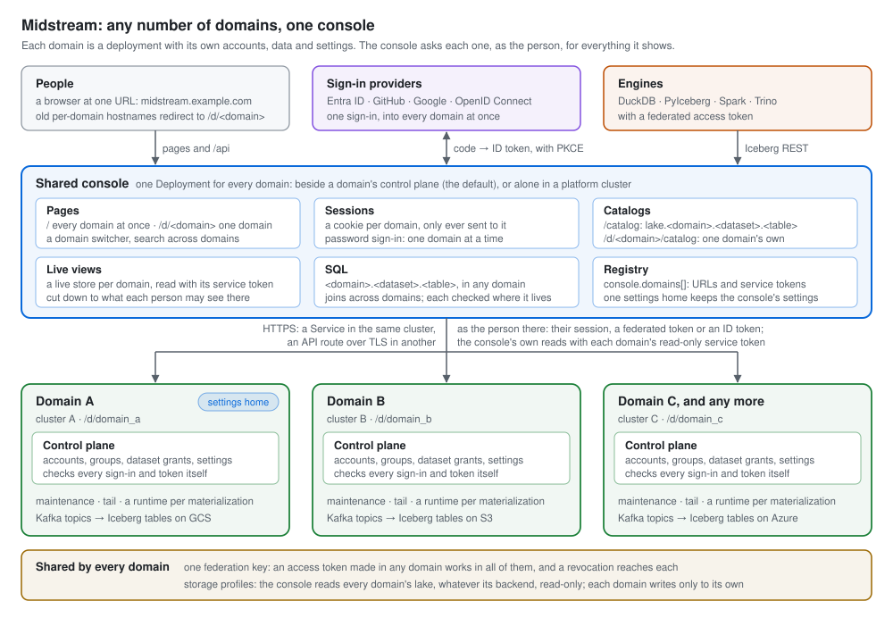
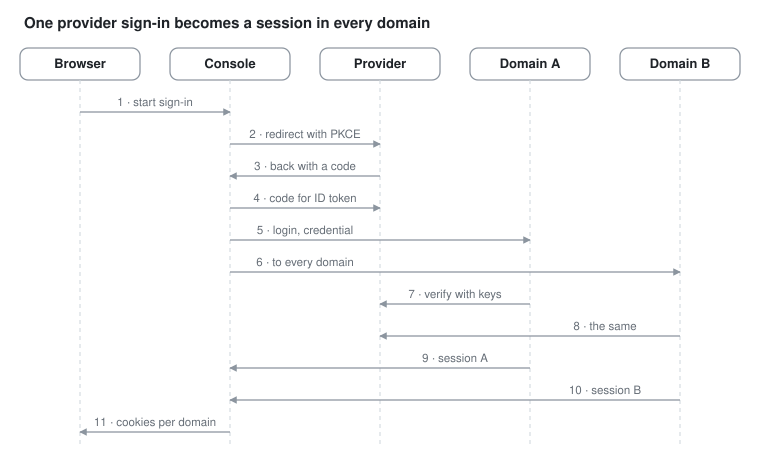

# 20 — Domains and the shared console

How any number of Midstream deployments — **domains** — work as one: one console at one URL over all
of them, one sign-in through Microsoft Entra ID, GitHub, Google or any OpenID Connect provider, one
access token for every domain, SQL that joins tables of several domains, and one Iceberg REST catalog
over all of them. Each domain keeps everything it had: its own control plane, runtimes, lake,
directory and catalog; nothing about a domain moves to the console.

Source: chart `charts/midstream/` (`values.yaml` `domain`, `console.domains`, `console.storage`,
`console.sso`, `auth.sso`, `route`, `ingress`; `templates/_helpers.tpl` `consoleDomains`,
`consoleStorage`, `consoleStorageEnv`, `ssoEnv`, `consoleSsoEnv`; `templates/route.yaml`;
`templates/console/deployment.yaml`); control plane
`python/src/midstream/identity/providers/` (`oidc.py`, `github.py`, `keys.py`, `http.py`),
`identity/access_tokens.py`, `identity/authorization.py`, `web/auth.py`, `web/tokens.py`,
`services/identity.py`, `table_names.py`, `config.py`, `web/system.py`; console
`console/server/domains/` (`registry.ts`, `domain.ts`, `index.ts`), `server/storage/` (`registry.ts`,
`profile.ts`), `server/auth/` (`guard.ts`, `cookies.ts`, `sso.ts`, `revocations.ts`), `server/routes/`
(`sso.ts`, `catalog.ts`, `search.ts`, `system.ts`, `data.ts`), `server/runs/names.ts`,
`src/lib/domains.tsx`. Design: `docs/design/multi-domain.md`, and for the storage profiles
`docs/design/storage-backends.md`.

## 20.1 The model in one paragraph

A **domain** is one Midstream deployment — one Helm release with a control plane, its apps, a
lake and a directory — named by an id (`domain_a`) and a name (*Domain A*). The **shared console**
is one console Deployment that serves every domain listed in its **registry**: a page about one
domain lives under `/d/<domain>/`, and the overview, the lists, search and the console's own
settings show every domain at once. The console holds one session per domain, in a cookie each;
signing in through a provider starts a session in every domain that admits the person, each domain
checking the provider's credential itself. Access tokens are signed with a **federation key** every
domain shares, so a token made in one domain is good in every domain where its owner has an account.
SQL names tables as `<domain>.<dataset>.<table>`; the federated catalog at `/catalog` names
namespaces `<domain>.<dataset>`. Exactly one domain, the **settings home**, stores the console's own
settings.



## 20.2 Topologies and the chart

One chart, three shapes, chosen by values:

| Release | `controlPlane.enabled` | `console.enabled` | `console.domains` |
|---|---|---|---|
| A domain with the console (the default) | true | true | empty: this domain alone, or every domain the console serves |
| A domain without a console | true | false | — |
| The console alone, in a platform cluster | false | true | every domain, none `local` |

**A domain's identity.** `domain.id` (default: the release's full name with `-` read as `_`) and
`domain.name` (default: the id) reach the control plane as `DOMAIN_ID` and `DOMAIN_NAME`, and
`GET /system/version` reports them with `federation_key_id` (§20.8). An id is checked by the chart and
by the console at start (`table_names.py::domain_id_problem`, `shared/tableNames.ts::domainIdProblem`):
`^[a-z][a-z0-9_]{0,31}$`, not one of DuckDB's reserved words or catalog names (`main`, `memory`,
`temp`, `system`, …), not `api`, `d`, `catalog` or `iceberg`, and not ending `_iceberg` — an id is a
URL segment, a catalog in SQL and a level of the federated catalog's namespaces.

**The registry.** `console.domains` lists the domains the console serves. Each entry:

| Key | Meaning |
|---|---|
| `id`, `name` | As the domain's own release sets them |
| `local: true` | This release's own domain, reached through its Services (`http://<release>-control-plane-app-api:6065`, `http://<release>-tail-app-api:6065`); its id must be this release's `domain.id` |
| `controlPlaneUrl` | Another domain's API: `https://<its route.hostnames[0]>`. Required unless `local` |
| `tailUrl` | Its tail app, usually the same host (its `/tail/` goes to the tail app); empty, that domain's tables show committed rows only |
| `serviceTokenSecret: {name, key}` | A Secret in the console's namespace holding that domain's `service-token`. Required unless `local` |
| `settingsHome: true` | Exactly one domain stores the console's own settings |

The chart refuses two settings homes or none, a domain named twice, a `local` domain in a release
without a control plane, and a remote domain without its URL or Secret. It renders the registry as
the ConfigMap `<release>-console-domains` (`domains.json`, mounted at `/etc/midstream`, read through
`CONSOLE_DOMAINS_FILE`), and each remote domain's token as `CONSOLE_DOMAIN_<ID>_SERVICE_TOKEN`; the
Deployment carries the registry's checksum, so a change rolls the console. `console.url` (default:
`https://<route.consoleHostnames[0]>`) is the URL people use: `CONSOLE_URL`.

**CI values.** `ci/test-values.yaml` (Domain A with the console serving Domain B, every provider on),
`ci/domain-only-values.yaml` (a domain without a console), `ci/console-only-values.yaml` (the console
alone, reading one domain's lake on GCS and another's on an S3-compatible server) — rendered by
`python/tests/test_chart_domains.py`, and their storage by `test_chart_storage.py`.

## 20.3 Hostnames, routes and redirects

| Hostname | Serves | Values |
|---|---|---|
| The console's, e.g. `midstream.example.com` | The console: its pages, `/api`, the federated catalog at `/catalog`, each domain's own catalog at `/d/<domain>/catalog` | `route.consoleHostnames` (Gateway API) or `ingress.consoleHost` |
| Each domain's API, e.g. `domain-a-api.example.com` | `/tail/…` to the tail app; everything else to the control plane: its API and its `/catalog` | `route.hostnames` or `ingress.host` |
| A domain's old person-facing hostname | `301` to `<console.url>/d/<domain id><path and query>` | `route.redirectFrom` or `ingress.redirectFrom` |

With Gateway API the chart renders three HTTPRoutes: `<release>-api`, `<release>-console` and
`<release>-redirect` — a `RequestRedirect` filter with `ReplacePrefixMatch` from `/` to
`/d/<domain id>/` and status 301. With an Ingress it renders the nginx annotation
`nginx.ingress.kubernetes.io/permanent-redirect: <console.url>/d/<domain id>$request_uri`. For any
other controller the chart renders no redirect: apply the rule by hand (§20.13).

Every view behind an API hostname authorizes its caller; only `GET /system/version` is public.
Expose a domain's API hostname only to the console's egress where you can, or put the console and
the control planes on a mesh with mTLS (§20.12).

## 20.4 The console's domains at run time

At start the console reads the registry (`server/domains/registry.ts`), refuses to start on a broken
one (an id that breaks the rule, an id named twice, a URL that is not http(s), not exactly one
settings home) — a domain without its service token is served, read as a guest, with a warning in
the log — and makes one `Domain` per entry (`server/domains/domain.ts`): its `ControlPlaneClient`, `LiveStore` (the
fleet and detail polls, as before, per domain), `TopicCatalog` and tail target. Every minute, and at
once when the domain's polls stop or start succeeding, it asks each control plane
`GET /system/version`:

| Status | When | The console |
|---|---|---|
| `ok` | The control plane answers as the registry says | serves the domain |
| `unreachable` | No answer yet, or the latest check failed | serves what it last knew, marked stale; a statement naming its tables is `503 domain_unreachable`; retries |
| `misconfigured` | The control plane says it is another domain | serves nothing of it; its pages say why |
| `incompatible` | Its release is older than the console works with | serves it, with a banner |

`GET /api/config` describes every domain to the person asking (`describeDomain`): status, version,
`federationKeyId`, live tail, autoscaling, and — only to someone who may create a materialization
there — the defaults a create starts from; and `federationKeysAgree`, false when two reachable
domains sign tokens with different keys. `GET /api/health` reports each domain's connectivity and
answers `degraded` while any domain cannot be read.

## 20.5 The console's pages and API

| Path | Page |
|---|---|
| `/`, `/materializations`, `/datasets`, `/search` | Every domain: the overview, the lists and search; rows link into their domain |
| `/sign-in`, `/sign-in/<domain>` | The providers, and a password sign-in for one domain |
| `/settings/{account,live,data,live-tail,security,topics,diagnostics,domains,deployment,history}` | The console's own settings, stored in the settings home; the registry; your account in each domain; every domain's change history merged |
| `/d/<domain>/…` | As before, inside the domain: its overview, materializations and their tabs, datasets |
| `/d/<domain>/settings/{users,groups,roles,security,sign-in,audit,materializations,…,deployment,history}` | The domain's settings and directory |

The API mirrors it. Under `/api/d/<domain>/` are every route that concerns one domain — its
materializations, datasets, topics, users, groups and roles, settings, its sign-in and tokens — each
authorized in that domain. The console-level routes are `/api/config`, `/api/health`,
`/api/auth/session`, `/api/auth/logout` (every domain), `/api/auth/sso/*` (§20.7), `/api/fleet` and
`/api/stream/fleet` (every domain's fleet in one answer, each domain's part with its access:
`ok`, `sign_in_required`, `forbidden` or `unavailable`), `/api/search?q=`, `/api/settings` (the
console's own, needing `settings.view`/`settings.manage` in the settings home) and `/api/runs/*` (a
run is addressed by its id; §20.9). An unknown domain in a path is `404 unknown_domain`; a
misconfigured one `503 domain_misconfigured`.

**Who the caller is.** The guard (`server/auth/guard.ts`) resolves the caller per domain: for a path
under `/api/d/<domain>/`, in that domain; for a console-level route, in every domain at once
(`request.auths`, domain id to caller). `permit(permission)` checks the request's domain;
`permitInHome` the settings home; `permitInSomeDomain` any domain; an all-domains answer is cut down
per domain.

**Search** (`server/routes/search.ts`) matches materializations by name, id or topic, tables by
`<dataset>.<table>` or `<domain>.<dataset>.<table>`, and datasets by name or description — in each
domain where the person may see them — from what the console holds already: each domain's live fleet,
and its datasets read with the service token and kept 30 s. The shell opens it with ⌘K or Ctrl+K.

## 20.6 Sessions and password sign-in

Each domain has its own session, in its own cookie, `<CONSOLE_SESSION_COOKIE>_<domain id>`
(`midstream_session_domain_a`), HttpOnly, `SameSite=Lax`, `Secure` behind TLS, holding that control
plane's session token; it is renewed on its own `refresh_after` and cleared when its control plane
refuses it. A domain without a cookie is visited as its guest. `GET /api/auth/session` answers
`{domains: {<id>: {state, error}}, providers}`: who the browser is in each domain, and the providers
the console offers. Signing out is per domain (`POST /api/d/<domain>/auth/logout`) or everywhere
(`POST /api/auth/logout`).

A password signs in to one domain: `/sign-in/<domain>`, or `/sign-in` with the domain chosen. A
domain may turn password sign-in off (`password_sign_in_enabled`, §20.7): then only accounts holding
the Administrator role may use one — checked after the password, so the refusal tells nobody anything
they did not know — and everyone else gets `403 password_sign_in_disabled`. A refusal of that kind is
audited but never counts towards a lockout. A password someone else chose holds the console back in
the domain that set it until it is changed; a session started through a provider is never held back
by it.

## 20.7 Single sign-on

The console runs the provider's flow; every domain checks the result itself, so a console can never
sign anyone in as someone else. Handbook 18 §18.17 is the reference for a domain's side; this is the
whole sequence.



| Provider | The console | Each domain checks | The account it signs in |
|---|---|---|---|
| Microsoft Entra ID (`entra`) | Authorization code with PKCE at `login.microsoftonline.com/<tenant>/oauth2/v2.0`; scopes `openid email profile`; an ID token | Signature against the tenant's keys, `iss` = `https://login.microsoftonline.com/<tenant>/v2.0`, `aud`, `exp`, `iat` within 5 min, the nonce once, `tid` = the tenant | `oid`; email from `email` or `preferred_username` |
| Google (`google`) | The same at `accounts.google.com`; `hd` as a hint when `hostedDomain` is set | Signature against Google's keys, `iss`, `aud`, `exp`, `iat`, the nonce, `email_verified`, `hd` among `hostedDomains` when any are set | `sub`; `email` |
| GitHub (`github`) | The code flow at `github.com/login/oauth`, scopes `read:user user:email`; an access token, revoked once every domain has answered | `POST /applications/<client id>/token` with the App's secret (the token was issued to this App), then `/user` and `/user/emails`: the account's id and its primary, verified email | the account id; that email |
| Any OpenID Connect issuer (`oidc`) | The same, endpoints from the issuer's discovery document | Signature against the issuer's published keys (discovery's `jwks_uri`), `iss`, `aud`, `exp`, `iat`, the nonce, `email_verified` unless `trustEmails` | `sub`; `email` |

**The flow** (`server/auth/sso.ts`, `server/routes/sso.ts`). `GET /api/auth/sso/<provider>/start?return=<path>`
remembers a pending flow — `state`, `nonce`, PKCE verifier, where to return — binds it to the browser
with the cookie `<CONSOLE_SESSION_COOKIE>-flow` (HttpOnly, path `/api/auth/sso`, ten minutes) and
redirects to the provider. The provider returns the browser to `<console.url>/api/auth/sso/<provider>/callback`
— the redirect URI to register — where the console checks the state against the cookie (a callback
works once, from the browser that started it), exchanges the code, and hands
`{provider, credential: {id_token} | {access_token}, nonce}` to every domain's `POST /auth/login` at
once. It keeps a session cookie for each domain that answered `200`, forgets the credential, and keeps
what each domain answered for five minutes: the page returned to shows it from
`GET /api/auth/sso/outcomes/<id>` (*Signed in to Domain A; Domain B: no account there*). Several
console replicas need sticky sessions for the flow, as for runs.

**In each domain** (`web/auth.py::sso_sign_in`, `identity/providers/`). The provider must be configured
by the deployment (`AUTH_SSO_*`) and turned on by the domain's setting `sso_<provider>_enabled`, else
`403 provider_disabled`. Keys come from the provider's key set, read again when a token names an
unknown key but at most once a minute (`identity/providers/keys.py`). Then the person is found:

1. the account linked to this provider account (`external-identity:<provider>:<subject>` in the
   directory), so a person whose email changes at the provider keeps their account;
2. else the account with the email the provider vouches for — linked from then on (identity request
   `link_identity`, audit `user.identity_linked`);
3. else, under the first-sign-in policy `open`, a new account in All Users (identity request
   `provision_user`, audit `user.provisioned`); under `invited`, `403 no_account`.

Allowed email domains (`sso_allowed_email_domains`) are checked first (`403 email_not_allowed`), and
a deactivated account is `403 account_deactivated`. A new account's id is derived from the provider
account (`usr-<sha256(provider:subject)>`), so two first sign-ins at once make one account, and the
first sign-in **waits for it**: the login view publishes `provision_user` and its next step holds the
answer until the identity agent has made the account (up to 10 s, then `503 provisioning`; `409` when
the agent refused it). Refusals for a known reason are audited as `session.sign_in_failed` with the
method `sso:<provider>` and never count towards a lockout.

**Settings** (a domain's *Sign-in* section, control-plane scope):

| Setting | Default (chart) | Meaning |
|---|---|---|
| `sso_entra_enabled`, `sso_github_enabled`, `sso_google_enabled`, `sso_oidc_enabled` | `auth.sso.<provider>.enabled` | Whether this domain takes sign-ins through the provider |
| `sso_first_sign_in` | `open` (`auth.sso.firstSignIn`) | `open` or `invited` |
| `sso_allowed_email_domains` | empty (`auth.sso.allowedEmailDomains`) | Email domains that may sign in through a provider; empty for any |
| `password_sign_in_enabled` | true (`auth.passwordSignIn`) | Off, only administrators sign in with a password |

The providers' identities — tenant, client ids, hosted domains, issuer, GitHub's client secret — are
the deployment's (`auth.sso.*` for a domain, `console.sso.*` for the console, the secrets from
Secrets) and are shown read-only on each Deployment section; a domain's values must match the
console's registration. In a release with both, an empty `auth.sso` value takes the console's.

### Registering the console with a provider

The console is registered once with each provider; every domain is given the same client id, so it
can check that what the provider says was said to this console. The redirect URI is always
`<console.url>/api/auth/sso/<provider>/callback`, spelled exactly; `console.url` is the console's
public URL (empty: `https://<route.consoleHostnames[0]>`). Client secrets go in Secrets, never in
values: `kubectl -n <namespace> create secret generic midstream-sso --from-literal=<key>=<secret>`,
named by `clientSecretSecret: {name: midstream-sso, key: <key>}`.

**Microsoft Entra ID** — one tenant per deployment.

1. In the Azure portal, open *Microsoft Entra ID › App registrations › New registration*.
2. Name it (*Midstream*); *Supported account types*: *Accounts in this organizational directory only
   (Single tenant)*; *Redirect URI*: platform *Web*, `<console.url>/api/auth/sso/entra/callback`.
   **Register**.
3. On its *Overview*, copy the *Application (client) ID* and the *Directory (tenant) ID*.
4. *Certificates & secrets › Client secrets › New client secret*; copy its **Value** (shown once)
   into a Secret in the console's namespace.
5. *Token configuration › Add optional claim › ID › email*, so the ID token carries the email (without
   it the domain uses `preferred_username`). *API permissions* keeps Microsoft Graph's delegated
   `User.Read`; grant admin consent if the tenant asks for it.
6. Values: `console.sso.entra: {enabled: true, tenantId, clientId, clientSecretSecret}`, and in every
   domain `auth.sso.entra: {enabled: true, tenantId, clientId}`.

**GitHub** — an OAuth App (not a GitHub App).

1. *GitHub › Settings › Developer settings › OAuth Apps › New OAuth App* — an organization's own
   *Settings › Developer settings* for one the organization owns.
2. *Application name* (*Midstream*), *Homepage URL* `<console.url>`, *Authorization callback URL*
   `<console.url>/api/auth/sso/github/callback`. **Register application**.
3. Copy the *Client ID*; **Generate a new client secret** and copy it (shown once).
4. Values: `console.sso.github: {enabled: true, clientId, clientSecretSecret}`, and in every domain
   `auth.sso.github: {enabled: true, clientId, clientSecretSecret}` — the domain needs the secret too,
   to ask GitHub whether a token was issued to this App; a domain in another release holds it in a
   Secret of its own. People sign in with their account's primary, verified email.

**Google** — an OAuth client in a Google Cloud project.

1. In the Google Cloud console, choose the project, then *Google Auth Platform* (*APIs & Services ›
   OAuth consent screen*): the app's name and support email; *Audience* **Internal** to admit only
   your Google Workspace organization, or **External** — while it is *Testing*, only the test users
   listed there can sign in.
2. *Clients › Create client*, type *Web application*; *Authorized redirect URIs*
   `<console.url>/api/auth/sso/google/callback`. **Create**, and copy the client id and secret.
3. The scopes asked for — `openid email profile` — need no verification by Google.
4. Values: `console.sso.google: {enabled: true, clientId, clientSecretSecret, hostedDomain}` (the
   hint for Google's account chooser), and in every domain `auth.sso.google: {enabled: true, clientId,
   hostedDomains: [example.com]}`. In production, set `hostedDomains`: without it any Google account
   whose email is verified passes Google's check, and only the domain's first-sign-in policy and
   allowed email domains stand between it and an account.

**Any OpenID Connect provider** — Okta, Keycloak, Auth0, Dex.

1. Register a confidential client using the authorization code flow, with the redirect URI
   `<console.url>/api/auth/sso/oidc/callback` and the scopes `openid email profile`. Dex, for example:

   ```yaml
   staticClients:
     - id: midstream-console
       name: Midstream
       secret: <from a Secret>
       redirectURIs: [https://midstream.example.com/api/auth/sso/oidc/callback]
   ```
2. Values: `console.sso.oidc: {enabled: true, issuer, clientId, clientSecretSecret, label}` and in
   every domain `auth.sso.oidc: {enabled: true, issuer, clientId, label}`; `trustEmails: true` only for
   an issuer that vouches for every email it puts in a token but leaves out `email_verified`. The
   issuer must serve `<issuer>/.well-known/openid-configuration` to the console and to every domain.

Then turn it on where wanted: each domain's *Settings › Sign-in*, or `auth.sso.<provider>.enabled`.
The sign-in page offers a provider once the console is registered with it and a domain takes it.

## 20.8 Federated access tokens

One token lets an engine read in every domain where its owner has an account; each domain checks it
on its own (`identity/access_tokens.py`, handbook 18 §18.15).

**The token.** `tok_<claims>.<signature>`: base64url JSON claims and an HMAC-SHA256 under the
federation key, `federation-key` in every domain's auth Secret, the same value everywhere (with
`previous-federation-key` for rotation, as the session signing key has). The claims are signed, not
encrypted:

| Claim | Holds |
|---|---|
| `jti` | The token id, 12 hex characters |
| `iss` | The domain that made it |
| `own` | Its owner: the provider account they signed in with, if any, and their email |
| `perm` | `catalog.read`, optionally `catalog.write` |
| `ds` | Optional: the datasets it is limited to, as `<domain>.<dataset>` |
| `iat`, `exp`, `kid` | Made, expires (at most 365 days later), and which key signed it |

**Making one.** `POST /api/d/<domain>/auth/tokens` (`web/tokens.py`): the domain checks the person
holds each permission on its own datasets named, or somewhere in the domain, signs the token, and
publishes `create_access_token` so the identity agent records `token:<jti>` for its listing; the
console shows the text only once the agent has recorded it. A token the agent refuses — over the
limit of 20, a dataset gone — is revoked as it is refused, so it works nowhere.

**Checking one** (`identity/authorization.py::_token_principal`), in any domain: the signature with
the domain's current or previous federation key, `exp`, no `revoked:<jti>` record, then the owner —
by provider account, else by email, active — or `401 token_unknown_owner`; then, as before, the
token's permissions intersected with what the owner holds **in this domain**, and `ds` applied to
this domain's datasets named in it (a token limited to other domains' datasets reads nothing here).

**Revoking one.** `DELETE /api/d/<domain>/auth/tokens/<jti>` on the domain that made it records
`revoked:<jti>` with a **signed revocation** (`{jti, exp, signature}`, the signature under the
federation key), and the console hands it to every other domain's
`POST /auth/tokens/revocations`, which needs no session — the signature is the proof — and records the
same (`token.revocation_applied`). A domain that cannot be reached then is told again: every five
minutes the console reads each domain's revocations since it last looked
(`GET /auth/tokens/revocations?since=`, with the service credential) and hands them on
(`server/auth/revocations.ts`). A revocation is kept until a day after its token expires.

**The key.** `GET /system/version` reports `federation_key_id`, the first 8 hex characters of the
key's SHA-256; the console's Domains section flags a domain whose key differs, and the About dialog
says the domains disagree. Rotate it in every domain within one change window: the current key into
`previous-federation-key`, a new one into `federation-key`, restart the control planes, and remove the
previous key after the longest token lifetime. Whoever holds it can sign a token for any owner, up to
that owner's grants: it lives only in the auth Secrets, never in the console.

## 20.9 SQL across domains

A statement names tables as `<domain>.<dataset>.<table>`, in any domain the console serves, and their
native Iceberg tables as `<domain>_iceberg.<dataset>.<table>`; a name without its domain is refused
with the name to write instead, so a statement reads the same wherever it is pasted (`server/runs/names.ts`).

**Finding the tables** (`server/routes/data.ts::resolveStatement`). Each name is found through its
domain's live fleet — the materialization whose tables include `<dataset>.<table>` — then its
detail, for the table's location; a name no domain holds is `400` listing what the dataset holds.
The person must be allowed `data.query` on each table's dataset, as that domain knows them: no session
there is `401`, a missing grant `403`, each naming the dataset with its domain.

**The sandbox.** As before, one DuckDB instance per statement, allowed to open exactly the run's
files (console 12 §12.4) and holding the secrets of the storage profiles those files are read with,
and no others (§20.11), so one statement joins tables on different backends; each domain named, and
its native catalog, is attached as an in-memory database, a schema per dataset, a view per table
(`server/runs/view.ts::statementViews`), so DuckDB resolves `domain_a.sales.orders` itself. Every
table is read at its own current snapshot — the request's own table at `asOf` when given — bounded by
the run's time range, and with its live tail read from its **own** domain's tail app with the
person's session there. A run's `tables` say each table's domain, dataset and materialization; the
status line names the domains a statement read; exporting needs `data.export` on every table it read,
in each one's domain.

**Masked columns across domains.** A hashed column joins another domain's only when both domains hash
with the same protection key (22 §22.8): `GET /system/version` reports each domain's
`protection_key_id`, which the deployer compares. Like the federation key, sharing it is the
installer's choice — generate one and patch it into each domain's auth Secret.

**The Data tab** writes full names into the statement it starts from, completes the materialization's
own tables with their columns and every other domain's tables by name, and keeps Live for the
domain's own table; a statement spanning domains has *Auto re-run* only.

## 20.10 The federated catalog

The console serves one Iceberg REST catalog at `<console.url>/catalog` whose namespaces are
`<domain>.<dataset>`, and each domain's own catalog at `<console.url>/d/<domain>/catalog`
(`server/routes/catalog.ts`). It stores and caches nothing: the caller's bearer token — a federated
access token or a session — goes to the domain unchanged, the domain decides, and the engine reads
the data files itself with its own credentials (§20.11).

| Request | The console answers |
|---|---|
| `GET /v1/config` | The same endpoints a domain lists |
| `GET /v1/namespaces` | One namespace per domain whose catalog lists something for the token; a domain that refuses it is left out, an unreachable one left out and logged |
| `GET /v1/namespaces?parent=domain_a` | That domain's datasets, `["domain_a", "sales"]` |
| `GET`/`HEAD /v1/namespaces/domain_a` | The domain, its name as a property |
| `GET`/`HEAD /v1/namespaces/domain_a%1Fsales`, `…/tables`, `…/tables/{t}` (`GET`, `HEAD`, `POST`), `…/metrics` | Handed to Domain A with the namespace rewritten to `sales`; namespaces in the answer rewritten back; a table answered as the domain answered it |
| Creating or dropping namespaces or tables, transactions | `501 NotImplementedException`, as every domain answers |

A domain the console cannot reach is `503 ServiceUnavailableException` naming it — including one whose
gateway answers for it with a page of its own (a 404 or 5xx that is not a catalog's JSON error), as a
gateway does when the domain's route or cluster is gone. Each domain's own
catalog is handed through byte for byte, path, query, token and body. The Table tab's Connect panel
gives PyIceberg and Spark the federated catalog (`lake.<domain>.<dataset>.<table>`), and DuckDB and
Trino — which read one level of namespaces — the domain's own catalog, attached once per domain (§20.15).

## 20.11 Lake access

Each domain writes its own lake, on its own backend, with its own credentials (`storage.*` in its
release, 02 §2.9a; 12 §12.12a). The console reads every domain's lake through its **storage profiles**
(`console.storage`, console 03 §3.6a): one per destination prefix, each with a kind — `gcs`, `s3` or
`azure` — its endpoint, region and path style, and read-only credentials of its own, from a Secret as
`CONSOLE_STORAGE_<NAME>_*` or from the console's cloud identity (`console.podLabels`,
`console.serviceAccountAnnotations`). The profiles know nothing of domains: a table is read by its
location alone.

```yaml
console:
  storage:
    - name: domain-a
      scope: gs://example-lake/            # Domain A's destination
      kind: gcs
      credentialsSecret: domain-a-lake-reader
    - name: domain-b
      scope: s3://example-lake-b/          # Domain B's, on an S3-compatible server
      kind: s3
      endpoint: https://s3.example.com
      pathStyle: true
      credentialsSecret: domain-b-lake-reader
```

**Longest prefix wins.** Every object — a pointer, a manifest, a data file — is read with the profile
whose `scope` is the longest prefix of its URI, a plain, case-sensitive string match, exactly as DuckDB
picks among scoped secrets, so the console and DuckDB never disagree about which credentials read a
file. Scopes end with `/` and are unique, and nested ones are allowed: `s3://example-lake/` for most
tables and `s3://example-lake/finance/` with credentials of its own. A location no profile covers is
never read — not even anonymously, as DuckDB would read an uncovered path from the public cloud — and
its table answers `503 storage_not_configured`: "no storage is configured for <uri>; add a storage
profile whose scope covers it". An `s3://` path names a bucket, not a server, so the console refuses
two `s3` profiles that serve one bucket through different endpoints (§20.16).

**Statements across backends.** A statement's sandbox gets the DuckDB secret, and for Azure the
extension, of each direct profile its files are read with, and no other: a statement joining
`domain_a.sales.orders` on GCS with `domain_b.finance.payments` on S3 reads each with its own
profile, and `duckdb_secrets()`, which would list the secrets, is refused (console 07 §07.10,
console 12 §12.4). A profile in cached mode — `"access": "cached"`, a GCS profile without an HMAC
key, or an Azure profile on an emulator with neither a connection string nor the account key — has
its files downloaded first, and the sandbox reads the local copies.

**Engines bring their own.** The federated catalog, like each domain's own, vends no storage
credentials: an engine on it reads each table's data files with credentials of its own for that
table's backend — a GCS HMAC key or Google credentials, an S3 access key or role with the server's
endpoint, an Azure account key, SAS or service principal — and an engine joining domains on different
backends needs each one's (04 §4.14). The Table tab's Connect panel prints the settings for the
table's backend, filled from the console's own profile for it: endpoint, region, path style, account,
never a credential. Whoever can read a bucket or container reads every table in it, whatever their
roles, and so does each storage profile over its scope (14 §14.8).

## 20.12 Security

| Boundary | What holds |
|---|---|
| Who checks identity | Each control plane, against the provider's keys or API; the console only runs the flow |
| The provider flow | Authorization code with PKCE; `state` bound to the browser by a cookie; a nonce every domain checks and uses once; an ID token at most 5 minutes old; the redirect URI matched exactly at the provider; the credential forgotten after the callback; GitHub's token revoked |
| Sessions | One HttpOnly, `SameSite=Lax`, `Secure` cookie per domain; changes from another site refused, as before |
| Service tokens | One per domain, read-only on its control plane; the console holds one per remote domain |
| Federated tokens | Signed, owner-bound, intersected with the owner's grants in the answering domain, revocable everywhere; the federation key lives only in the auth Secrets |
| API hostnames | Every view authorizes; `GET /system/version` is the only public view. Restrict them to the console's egress where possible |
| The catalog proxy | Passes the caller's token through, stores nothing, rewrites only namespaces |
| The lakes | Each domain writes only its own, with its own credentials; the console reads with read-only storage profiles, never a location no profile covers, and a statement's sandbox holds only the secrets of the profiles it reads (§20.11) |
| A provider outage | New sign-ins through it fail; sessions run to their limits; administrators sign in with a password |
| The console down | No pages for any domain; every domain's API and catalog keep working |

## 20.13 Operating it

**Adding a domain.** Install its release with `domain.id`/`domain.name`, its API hostname
(`route.hostnames`) and the shared `federation-key` in its auth Secret; copy its `service-token` into
a Secret in the console's namespace; add it to the console release's `console.domains` (with
`controlPlaneUrl`, `tailUrl`, `serviceTokenSecret`) and upgrade the console. Give the console read
access to its lake: a `console.storage` profile whose scope covers the domain's destination, with
read-only credentials for its backend — or, when an existing profile's scope covers it already, read
access for that profile's credentials (§20.11). Its providers: the same `auth.sso` identities as the
console's.

**Redirect rules by hand.** Every request to the old hostname answers `301` with
`Location: <console.url>/d/<domain id><original path and query>`:

```yaml
# Gateway API (rendered by the chart with route.redirectFrom)
apiVersion: gateway.networking.k8s.io/v1
kind: HTTPRoute
metadata: {name: domain-a-redirect}
spec:
  parentRefs: [{name: <gateway>}]
  hostnames: [domain-a.example.com]
  rules:
    - filters:
        - type: RequestRedirect
          requestRedirect:
            scheme: https
            hostname: midstream.example.com
            path: {type: ReplacePrefixMatch, replacePrefixMatch: /d/domain_a/}
            statusCode: 301
```

```yaml
# ingress-nginx (rendered by the chart with ingress.redirectFrom)
metadata:
  annotations:
    nginx.ingress.kubernetes.io/permanent-redirect: https://midstream.example.com/d/domain_a$request_uri
```

```yaml
# Istio: an Istio gateway serves the Gateway API HTTPRoute above, which keeps the path. A
# VirtualService redirect replaces the whole path, so every old URL lands on the domain's overview:
spec:
  hosts: [domain-a.example.com]
  gateways: [<gateway>]
  http:
    - redirect: {scheme: https, authority: midstream.example.com, uri: /d/domain_a/, redirectCode: 301}
```

```yaml
# Traefik Middleware
apiVersion: traefik.io/v1alpha1
kind: Middleware
metadata: {name: domain-a-redirect}
spec:
  redirectRegex:
    regex: ^https?://domain-a\.example\.com/(.*)
    replacement: https://midstream.example.com/d/domain_a/${1}
    permanent: true
```

```text
# HAProxy: `redirect prefix` keeps the path and query. With an HAProxy ingress controller, put the
# line in its configuration snippet for the old hostname's frontend or backend.
http-request redirect prefix https://midstream.example.com/d/domain_a code 301 if { hdr(host) -i domain-a.example.com }
```

```text
# Any other controller: three values
#   the old hostname        domain-a.example.com
#   the console's URL       https://midstream.example.com
#   the domain id           domain_a
# Rule: answer every request to <old hostname> with 301, Location: <console URL>/d/<domain id><path><?query>
```

**A domain down.** Its pages say it cannot be reached; the overview and lists show the other domains,
with a note naming it; its sessions stay in their cookies; a statement naming its tables fails naming
it; the federated catalog leaves it out of the top-level list and answers `503` for its namespaces.

**A federation key that differs.** The Domains section flags the domain; tokens made there are
refused elsewhere and vice versa. Put the same key in its auth Secret and restart its control plane.

## 20.14 Testing

| Level | Covers |
|---|---|
| Control plane (`unittest`) | `test_chart_domains.py` (the registry rules, routes and redirects, the three topologies); `test_chart_storage.py` (the console's storage profiles: the registry without credentials, each profile's Secret, the rules, one bucket on two endpoints refused); `test_sso.py` (each provider's check against a stub key set or GitHub API, account resolution, both policies, allowed domains, password sign-in off with the administrator exemption, provisioning and its wait); `test_federated_tokens.py` (sign, check, rotation, expiry, owners across domains, dataset limits per domain, revocation and its signature, forged revocations); `test_settings.py` (the Sign-in settings) |
| Console (`node --test`) | `domains/*.test.ts` (the registry), `auth/auth.test.ts` (one cookie per domain, the session map), `routes/sso.test.ts` (the flow: PKCE, state bound to the browser, a callback once, the fan-out, GitHub's revocation), `auth/revocations.test.ts` (handing revocations on, the five-minute pass), `routes/sql.test.ts` (a join across two domains, full names, refusals per domain, tails from each domain's tail app), `routes/catalog.test.ts` (the federated catalog's listing, rewriting and pass-through), `src/lib/*.test.ts` (paths, the merged fleet, key agreement), `storage/*.test.ts` (the storage registry and its rules, the longest scope serving each object, a location no profile covers refused, a sandbox given only its sources' profiles' secrets; against SeaweedFS, Azurite and fake-gcs-server, one statement joining tables on three backends — 13 §13.3a) |
| A test cluster | §20.15 |

## 20.15 Validated on a test cluster

On 2026-10-26 the test cluster ran two domains from this chart, on a clean slate: **Domain A**, the release
`midstream` with the shared console (the settings home), and **Domain B**, the release `midstream-b`
in its own namespace with no console, reached by the console only through its API route
`domain-b-api.example.com` — as a domain in another cluster would be. Builds under test came from
a temporary package index and registry on the cluster; the last, `1.0.0rc3.dev6`, was rolled onto both
domains as an upgrade (every app `Ready` and every runtime re-pinned in under two minutes). Dex stood
in for the sign-in provider (`oidc`). Checks ran through the console's API and in a browser
(Playwright, Chromium); the record is console 14 §14.4.

| Area | Verified |
|---|---|
| Install | Both releases `Ready` two minutes after `helm install`; the administrator's first sign-in in each domain asked for a new password; the console reported both domains `ok` with one federation key |
| Routing | A cookie per domain (`midstream_session_domain_a`, `…_domain_b`, HttpOnly, Secure, SameSite=Lax); the merged fleet and search across both; `404 unknown_domain`; `domain-a.example.com/<path>?<query>` → `301` to `/d/domain_a/<path>?<query>`; a change from another site `403`; a person only in Domain B a guest in Domain A |
| Sign-in through Dex | Someone neither domain knew: an account in both (`open`), signed in to both at once; Domain B `invited`: signed in to A, refused by B (`no_account`), said so; Domain A limited to `example.com`: refused by both, back on the sign-in page with each reason; password sign-in off in Domain B: a person's right password `403 password_sign_in_disabled`, a wrong one still `invalid_credentials`, the administrator still in, Domain A untouched |
| Access tokens | Made in Domain A: honoured by Domain A, Domain B, the federated catalog and Domain B's API directly; limited to `domain_b.finance`, it lists only Domain B and loads nothing of A; revoked in A, refused by every domain at once; made, limited and revoked from the Account page |
| SQL | `domain_a.shop.orders JOIN domain_b.finance.payments`: 25 rows before either table's first commit (each domain's live tail) and after; `domain_b_iceberg.…`; a name without its domain refused with the name to write; without a session in Domain B, `401` naming `domain_b.finance` |
| Catalogs | PyIceberg on `/catalog`: the domains, their datasets, both tables read; PyIceberg on `/d/domain_b/catalog`; DuckDB 2.0 on `/d/domain_a/catalog`, the 102,033,103-row table counted. **DuckDB 2.0 on `/catalog`** lists the domains as schemas but no tables under them, refuses `lake.domain_a.shop.orders` and reads a table only as `lake."domain_a.shop".orders` — so the Connect panel gives DuckDB (and Trino) each domain's own catalog, as decided; Spark and Trino were not run |

**Faults.**

| Fault | What happened |
|---|---|
| Domain B unreachable (its route removed, its control plane running) | Marked `unreachable` within 15 s; Domain A unaffected; the merged fleet kept B's last snapshot, marked; a statement naming a B table `503 domain_unreachable`; the federated catalog left B out and answered `503 ServiceUnavailableException` for its namespaces; a token revoked meanwhile reached B through the sync 106 s after B's return |
| The provider down (Dex scaled to 0) | *Dex cannot be reached right now*, no cookie set; passwords and existing sessions unaffected; with Dex back (new signing keys), sign-in worked at once — each domain read the new keys |
| Another federation key in Domain B | The console said the keys disagree; a token from A refused by B (`not valid`), honoured by A; with the shared key back, they agreed and new tokens worked in both |
| A control plane restarted (B, twice; A, the settings home) | Back in 20–52 s; sessions outlived it; while starting, it answered `503 starting` as itself |
| A misconfigured registry (domain_b sent to Domain A's API) | `domain_b` misconfigured, logged at `error` naming both domains; nothing of it served (`503 domain_misconfigured`), no sign-in to it, never A's materializations twice; served again once corrected |
| The console restarted | Signed-in browsers stayed signed in; a sign-in half-way through Dex came back *expired — sign in again* |
| Domain B's tail app down | A statement over both domains ran on B's committed rows, B's tail `unavailable`, A's read; back once the tail app returned |

**Found and fixed during the validation** (each with its regression test): a statement started in one
domain naming another's table failed with a 500 — the caller is now resolved in each domain a
statement names (`97df65d`); a gateway's own 404 or 5xx for a domain that is gone was read as the
control plane's — materializations "not found", a bare 404 to engines — and a domain that had
answered once never showed unreachable (`84c4a62`); the merged fleet stream held its first frame for
its 100 ms merge window (`678ad09`); the console Settings page asked for the console's settings before
it knew the settings home (`c8ba672`); five audit actions showed as codes (`7d38627`).

**Performance against 1.0.0-rc.2** — the same test cluster, the same 111,031,820-offset load-test topic, the same
materialization (one replica, autoscaling to 16 members), the console measured the same way:

| Backfill | rc.2 | Domains |
|---|---|---|
| Rows committed | 102,033,103 | 102,033,103 |
| Create to the last commit | 89.4 min | 88.9 min |
| Average | 19,025 rows/s | 19,137 rows/s |
| Ingest at 16 members, p50 / p90 | 22,009 / 24,187 rows/s | 22,027 / 23,659 rows/s |
| Members at 16 after | 6.6 min | 6.7 min |

| Console request (p50 / p90, ms) | rc.2 | Domains |
|---|---|---|
| `GET /api/config` | 5.3 / 6.6 | 6.3 / 7.7 |
| The session | 5.8 / 6.7 | 5.8 / 7.1 |
| The fleet (rc.2's one; every domain's) | 8.2 / 9.1 | 6.5 / 8.0 |
| A materialization's detail | 6.5 / 7.8 | 8.0 / 8.5 |
| Settings | 10.6 / 12.5 | 11.0 / 13.0 |
| The fleet stream's first event | 7.7 / 19.6 | 7.8 / 10.3 |
| Password sign-in | 145–210 | 140–203 |
| Browse the newest rows, all time | 191 | 126 |
| One month grouped by partition (SQL) | 17.7 s | 16.8 s |
| `count(*)` over all time (SQL) | 207 s, 1,192 files | 249 s, 1,467 files |

The last row scans every data file: the two tables differed only in how far compaction had gone when
it ran, and per file the scan is the same (0.174 s and 0.170 s). Nothing on the data path — runtime,
committer, maintenance app, tail app — changed between the two builds. Idle, the control plane, the
maintenance and tail apps and a fresh console used what they did on rc.2 (the console 2–3 millicores
and 68–98 MiB; the control plane 8 millicores and 139 MiB); Domain B's own apps add their share.

## 20.16 Known edges

- A domain's API hostname exposes every control-plane view to whoever can reach it; each authorizes,
  but restricting the hostname to the console's egress is the operator's (§20.12).
- Pending sign-in flows and runs live in the console's memory: several replicas need sticky sessions.
- A token's dataset limits name datasets by name: a dataset deleted and made again with the same name
  is the same limit.
- `request`, a first-sign-in policy that makes a pending account for an administrator to approve, is
  not built.
- The console's storage profiles are its own, not the domains': a domain on a new bucket, prefix or
  backend is unreadable in the console until a profile covers its destination (§20.11).
- An `s3://` path names no server, so one console cannot read two domains whose lakes are buckets of
  the same name on different S3 servers: the console and the chart refuse two `s3` profiles that serve
  one bucket through different endpoints (14 §14.20).
